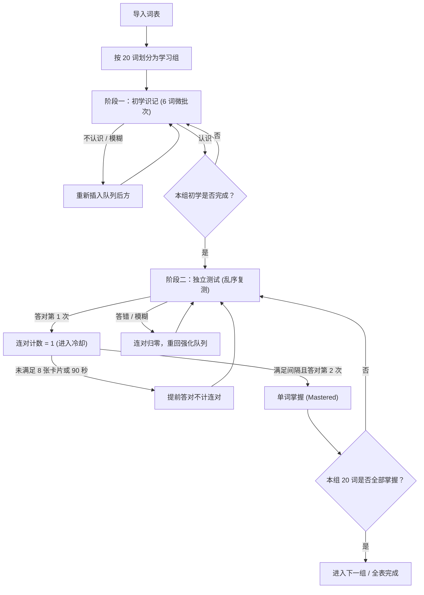

# Vocab Memorier

一个面向高效记忆、支持离线优先（Offline-First）与私有化多设备云同步的英语单词记忆 Web 应用。内置牛津高阶英汉双解词典，采用 20 词组循环记忆机制；支持访客免登录离线使用，亦可一键部署轻量服务端实现多用户账户管理、多端进度差异化同步与管理员后台。

---

## 核心特性

### 1. 组循环记忆流程 (20 词/组速背机制)
- **分组学习**：词表默认按每组 20 词进行切分，必须完成当前组的掌握考核后方可进入下一组。
- **阶段一：初学识记**：组内按 6 词微批次循环推进；评定为「不认识」或「模糊」的卡片会自动回退到队列后方重测。
- **阶段二：独立测试**：全组打乱进入闭卷测试，每个单词需**连续答对 2 次**才算掌握。
- **防虚假熟悉（OR 间隔条件）**：两次答对之间必须间隔至少 8 张其他卡片，或者物理时间经过至少 90 秒。未满足条件的提前答对不计连对。
- **极致流畅**：卡片切换采用同步状态提交与词典预查机制，无页面重排与闪烁。

### 2. 内置词典与离线查询
- **内置离线词典**：集成牛津高阶英汉双解词典（OALDPE），包含约 7 万实体词条与 54 万屈折跳转映射，支持完全无网络环境下查询音标、词性与中文释义。
- **自定义 MDX 词典扩展**：支持在设置中上传包含 `.mdx` 文件的 `.zip` 压缩包。系统在前端高速解压并解析 MDX 文件，增量合并到本地词库。

### 3. 多账户体系与管理员后台 (RBAC)
- **极简本地部署友好**：无需依赖外部 SMTP 邮件服务器或第三方验证平台，支持用户名/邮箱直接注册登录，采用 `scrypt` 16 字节随机加盐哈希与 `timingSafeEqual` 安全存储和校验凭据。
- **角色权限隔离**：
  - **普通用户 (`user`)**：独立管理个人单词本、背词记录与设置，支持修改密码、更新用户名与邮箱（无需邮件验证）及自愿注销账户。
  - **系统管理员 (`admin`)**：专属管理后台，支持查看用户列表、分页与防抖搜索、手动开户、重置用户密码（重置后即刻踢下线）、删除违规账户及查看审计日志。
- **会话与安全性保障**：
  - 30 天持久化 Session Token，服务端单向 SHA-256 哈希校验；
  - 登录与注册接口集成滑动窗口速率限制（Rate Limiting），有效防范暴力破解；
  - 防自删与最后管理员死锁保护，事务中级联清理个人数据，绝不影响全局共享词典与其他用户；
  - 公开注册开关：管理员可在后台随时关闭/开放自由注册，关闭后系统转为仅管理员手动分配账户。

### 4. 离线优先与多端差异化云同步 (Cloud Sync)
- **免登录游客模式 (Guest)**：未登录时完全可用，所有词本与学习进度保存在本地；游客首次注册新账户时，本地数据将平滑迁移至云端专属库。
- **物理分库多账户隔离**：在前端 IndexedDB 物理层为访客（`vocab-memorier-guest`）与每个登录用户（`vocab-memorier-user-${userId}`）独立分库，切换账户或退出登录绝不交叉污染。
- **权威差异化合并算法**：
  - **学习成果深度保护**：对于已掌握（`MASTERED`）的单词，多端合并时优先保留掌握态与高连胜记录，严禁粗暴 LWW（最后写入胜出）覆盖已背单词；
  - **复习日志全局去重**：打卡流水日志按唯一 UUID 求并集去重（INSERT OR IGNORE），打卡记录永不丢失；
  - **软删除标记传播**：单词本与词本成员采用 `isDeleted` 标记与时间戳协同判定，确保多端删除准确同步；
  - **高性能批量合并**：前端采用 O(1) 内存比对 + `bulkPut` 批量写入，大幅降低 IndexedDB 事务耗时。

### 5. 数据导入与备份恢复
- **格式支持**：支持批量导入 `.txt` 和 `.csv` 词表。
- **自动清洗**：自动剔除重复词，支持行尾备注格式（如 `convert（已认识）` 或自定义中文释义）。
- **标准备份导出**：提供 JSON 格式的完整词本、卡片进度与学习日志导入导出。

---

## 学习流程示意



---

## 键盘快捷键

| 快捷键 | 场景 | 说明 |
|:---|:---|:---|
| <kbd>Space</kbd> / <kbd>Enter</kbd> | 未翻面（正面） | 揭示答案（显示释义与音标） |
| <kbd>Space</kbd> / <kbd>Enter</kbd> | 已翻面（背面） | 评定为「认识」 |
| <kbd>1</kbd> | 已翻面（背面） | 评定为「不认识」，排回强化队列 |
| <kbd>2</kbd> | 已翻面（背面） | 评定为「模糊」，排回强化队列 |
| <kbd>3</kbd> | 已翻面（背面） | 评定为「认识」，累计掌握进度 |
| <kbd>Z</kbd> | 答题中 | 撤销上一步操作（恢复卡片状态与队列） |

---

## 快速上手与部署教程

> **运行环境要求**：由于服务端直接使用 Node.js 内置原生 SQLite (`node:sqlite`) 与原生 TypeScript 类型剥离 (`--experimental-strip-types`)，请确保 **Node.js 版本 $\ge$ 22.6.0**（推荐 Node.js 22 LTS 或 24+）。

### 1. 安装依赖
```bash
cd /opt
git clone https://github.com/Sunny090623/vocab-memorier.git
cd vocab-memorier
npm install
```

### 2. 初始化管理员账户
在首次部署或需要重置管理员密码时，可通过以下任一方式初始化管理员账户：

**方式一：命令行参数一键创建 / 重置（推荐）**
```bash
npm run init:admin -- --email=admin@vocab.local --password=your_secure_password --username=系统管理员

# 或直接使用 node 执行：
node --experimental-strip-types server/scripts/initAdmin.ts --email=admin@vocab.local --password=your_secure_password --username=系统管理员
```

**方式二：交互式终端向导创建**
```bash
npm run init:admin
# 根据终端提示依次输入管理员邮箱、密码（至少 6 位）与昵称即可
```

**方式三：首次启动时通过环境变量自动引导**
当数据库中尚无任何管理员账户时，启动服务前传入 `ADMIN_EMAIL` 和 `ADMIN_PASSWORD` 环境变量即可自动创建首个管理员：
```bash
ADMIN_EMAIL=admin@vocab.local ADMIN_PASSWORD=your_secure_password npm run serve
```

---

### 3. 本地开发与本地生产运行

#### (1) 本地开发模式（热更新 + API 中间件）
```bash
npm run dev
```
Vite 开发服务器将在 `http://localhost:3000` 启动，并自动挂载 `/api/*` 认证与云同步后端接口。

#### (2) 本地生产构建与全栈运行
> ⚠️ **注意**：请勿使用 `python -m http.server` 等纯静态文件服务器直接运行 `dist/`，因为纯静态服务器不支持 `POST /api/auth/login` 等动态接口（会返回 `HTTP 501` 或 `HTTP 405`）。请使用内置全栈服务命令：

```bash
# 1. 编译前端生产静态资源到 dist/
npm run build

# 2. 启动全栈生产服务器（同时托管 dist/ 静态页面与 /api/* 后端接口）
npm run serve
```
启动后访问 `http://localhost:3001`（或通过 `PORT=8080 npm run serve` 指定端口）即可使用完整功能。

---

### 5. 远程服务器生产部署教程（Nginx + Node.js 后端）

在远程 Linux 服务器部署时，前端编译产物由 Nginx 高效托管或反代，`/api/` 动态请求转发给 Node.js 后端服务。

#### 第一步：在服务器上拉取代码并构建
```bash
cd /opt
git clone https://github.com/Sunny090623/vocab-memorier.git
cd vocab-memorier
npm install
npm run build

# 初始化管理员账号（请替换为您自己的密码）
npm run init:admin -- --email=admin@vocab.local --password=YourStrongPassword123 --username=系统管理员
```

#### 第二步：后台常驻运行 Node.js 后端服务（监听 `127.0.0.1:3001`）

你可以选择 **Systemd**（系统自带，推荐）或 **PM2** 来守护后端进程：

**选项 A：使用 Systemd 守护进程**
创建 `/etc/systemd/system/vocab-memorier.service`：
```ini
[Unit]
Description=Vocab Memorier Full-Stack Server
After=network.target

[Service]
Type=simple
User=www-data
WorkingDirectory=/opt/vocab-memorier
Environment=NODE_ENV=production
Environment=PORT=3001
Environment=DATABASE_PATH=/opt/vocab-memorier/data/vocab_server.db
ExecStart=/usr/bin/env node --experimental-strip-types server/index.ts
Restart=always
RestartSec=5

[Install]
WantedBy=multi-user.target
```
启动并设置开机自启：
```bash
# 确保数据目录权限正确
mkdir -p /opt/vocab-memorier/data
chown -R www-data:www-data /opt/vocab-memorier/data

sudo systemctl daemon-reload
sudo systemctl enable --now vocab-memorier
sudo systemctl status vocab-memorier
```

**选项 B：使用 PM2 守护进程**
```bash
PORT=3001 pm2 start "node --experimental-strip-types server/index.ts" --name vocab-memorier
pm2 save
```

#### 第三步：配置 Nginx（两种方式任选其一）

##### 方式一：Nginx 直接托管 `/var/www/vocab-memorier` 静态文件 + 反代 `/api/`（最常用）
如果你习惯将 `dist/*` 复制到 `/var/www/vocab-memorier`：
```bash
sudo mkdir -p /var/www/vocab-memorier
sudo cp -r /opt/vocab-memorier/dist/* /var/www/vocab-memorier/
```
然后在 Nginx 站点配置（如 `/etc/nginx/sites-available/vocab.conf`）中**务必加上 `location /api/` 反向代理块**（否则静态 Nginx 收到登录 `POST` 请求会报 `405 Not Allowed`）：

```nginx
server {
    listen 80;
    server_name _;

    root /var/www/vocab-memorier;
    index index.html;

    # 1. 核心：将所有 /api/ 请求反向代理至 Node.js 认证与同步后端
    location /api/ {
        proxy_pass http://127.0.0.1:3001;
        proxy_http_version 1.1;
        proxy_set_header Host $host;
        proxy_set_header X-Real-IP $remote_addr;
        proxy_set_header X-Forwarded-For $proxy_add_x_forwarded_for;
        proxy_set_header X-Forwarded-Proto $scheme;
        client_max_body_size 20m;
    }

    # 2. 静态词典分片读取支持
    location /dicts/ {
        try_files $uri =404;
        add_header Accept-Ranges bytes;
    }

    # 3. 前端 React 路由 SPA 回退
    location / {
        try_files $uri $uri/ /index.html;
    }
}
```

##### 方式二：Nginx 全站直接反向代理至 `127.0.0.1:3001`（无需手动复制 `dist/`）
因为 `npm run serve` 已内置 `dist/` 静态资源服务与 HTTP Range 支持，你也可以直接将全站反代给 `3001` 端口：
```nginx
server {
    listen 80;
    server_name _;

    client_max_body_size 20m;

    location / {
        proxy_pass http://127.0.0.1:3001;
        proxy_http_version 1.1;
        proxy_set_header Host $host;
        proxy_set_header X-Real-IP $remote_addr;
        proxy_set_header X-Forwarded-For $proxy_add_x_forwarded_for;
        proxy_set_header X-Forwarded-Proto $scheme;
    }
}
```

配置完成后重载 Nginx 即可生效：
```bash
sudo nginx -t && sudo systemctl reload nginx
```

---

## 环境变量说明

| 变量名 | 默认值 | 说明 |
|:---|:---|:---|
| `PORT` | `3001` | `npm run serve` 全栈服务端监听端口 |
| `DATABASE_PATH` | `./data/vocab_server.db` | 服务端 SQLite 数据库物理存储路径 |
| `ALLOW_PUBLIC_REGISTRATION` | `true` | 首次建库时是否开放公开注册（后续可在管理员后台动态切换） |
| `ADMIN_EMAIL` | 无 | 当数据库尚无管理员时，配合 `ADMIN_PASSWORD` 自动引导创建首个管理员邮箱 |
| `ADMIN_PASSWORD` | 无 | 当数据库尚无管理员时，自动引导创建的首个管理员密码（至少 6 位） |
| `ADMIN_USERNAME` | `系统管理员` | 自动引导创建的首个管理员昵称 |

---

## 项目结构与技术栈

```
vocab-memorier/
├── server/                        # 轻量服务端 (Node.js 原生 + SQLite WAL)
│   ├── admin.ts                   # 管理员后台 API (用户管理/配置/审计日志)
│   ├── app.ts                     # HTTP 服务网关与路由分发
│   ├── auth.ts                    # 用户认证与 Session 鉴权
│   ├── crypto.ts                  # PBKDF2 密码加盐哈希与 Token 生成
│   ├── db.ts                      # SQLite 模式定义、覆盖索引与 PRAGMA 配置
│   ├── rateLimiter.ts             # 认证防爆破滑动窗口限流器
│   ├── sync.ts                    # 差异化云同步合并引擎
│   └── scripts/initAdmin.ts       # 命令行管理员初始化脚本
├── src/                           # 前端源码
│   ├── core/
│   │   ├── auth/                  # 认证上下文 (AuthContext) 与会话管理
│   │   ├── dict/                  # MDX 解析器与词典资源加载
│   │   ├── importer/              # 词表文本解析与归一化
│   │   └── scheduler/             # 调度算法、状态机与间隔规则
│   ├── data/
│   │   ├── api/                   # 前端 API 请求层 (authApi, adminApi, syncApi)
│   │   ├── backup/                # 备份导出与导入
│   │   ├── db/                    # Dexie (IndexedDB) 数据库与多账户物理隔离代理
│   │   ├── repos/                 # 仓储层接口与实现
│   │   └── sync/                  # 客户端增量同步服务 (SyncService)
│   ├── features/
│   │   ├── admin/                 # 系统管理后台 (AdminDashboardPage)
│   │   ├── auth/                  # 登录、注册与个人账户页
│   │   ├── decks/                 # 单词本管理
│   │   ├── import/                # 词表导入与预览
│   │   ├── settings/              # 词典管理、主题与备份
│   │   ├── stats/                 # 学习进度统计
│   │   └── study/                 # 背词界面与卡片交互
│   ├── hooks/                     # 状态与背词流程逻辑封装
│   └── ui/                        # Material Design 3 组件规范实现
├── tests/                         # 自动化测试
│   ├── unit/                      # Vitest 单元测试 (调度/同步/鉴权/账户隔离)
│   ├── integration/               # 仓储与持久化集成测试
│   └── e2e/                       # Playwright 端到端全链路测试
└── tools/                         # 词典离线处理与构建工具
```

- **前端技术栈**：React 19、TypeScript 5.8、Vite 6.4、Dexie.js (IndexedDB)、fflate、PapaParse
- **服务端技术栈**：Node.js 原生 HTTP (`node:http`)、原生 SQLite (`node:sqlite` WAL 模式)
- **UI 设计规范**：Material Design 3 Token 与组件体系，支持深色/浅色/跟随系统模式
- **测试框架**：Vitest 3.2、Playwright (Chromium)

---

## 开源协议

本项目采用 [MIT](LICENSE) 协议开源。
内置词典资源仅供个人学习与离线研究使用。
