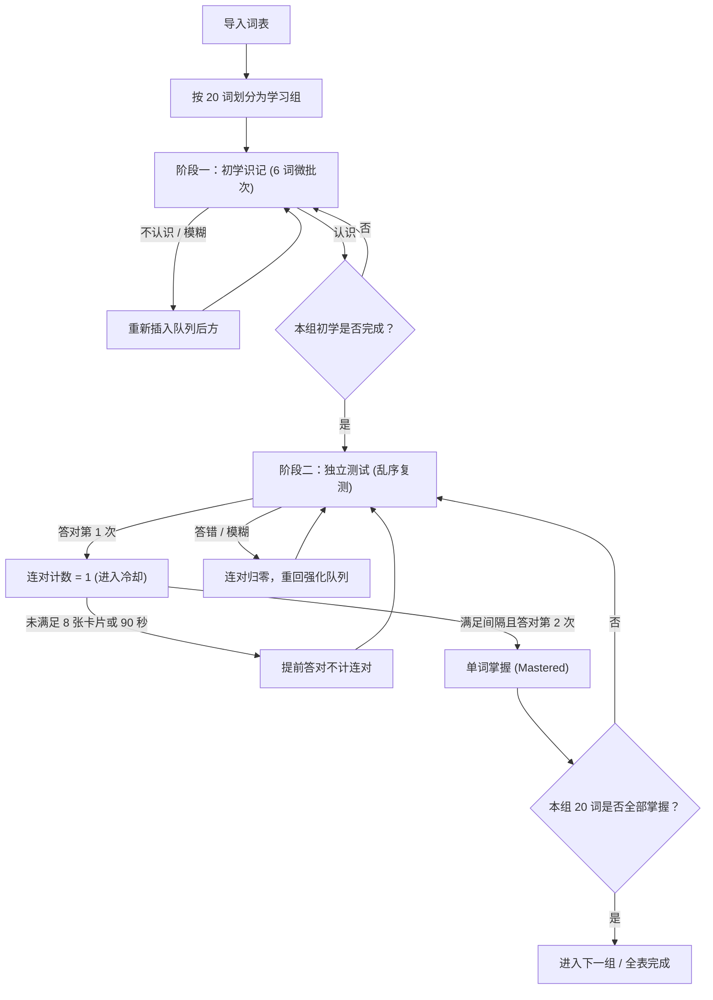

# Vocab Memorier

一个纯前端、本地离线运行的英语单词记忆 Web 应用。内置牛津高阶英汉双解词典，采用 20 词组循环记忆机制，所有数据均保存在浏览器本地（IndexedDB），不依赖后端服务。

---

## 功能介绍

### 1. 内置词典与离线查询
- **内置词典**：集成牛津高阶英汉双解词典（OALDPE），包含约 7 万实体词条与 54 万屈折跳转映射，支持在无网络环境下查询音标、词性与中文释义。
- **自定义 MDX 词典扩展**：支持在设置中上传包含 `.mdx` 文件的 `.zip` 压缩包。系统在浏览器端解压并解析 MDX 文件，采用增量合并策略追加到本地词库。

### 2. 组循环记忆流程 (20 词/组)
- **分组学习**：词表默认按每组 20 词进行切分，必须完成当前组的掌握考核后方可进入下一组。
- **阶段一：初学识记**：
  - 组内按 6 词微批次循环推进。
  - 评定为「不认识」或「模糊」的卡片会自动回退到队列后方重测，避免连续立即重复。
- **阶段二：独立测试**：
  - 本组 20 词初学完成后，全组打乱进入闭卷测试。
  - 每个单词需**连续答对 2 次**才算掌握。
  - **间隔要求（OR 条件）**：两次答对之间必须间隔至少 8 张其他卡片，或者物理时间经过至少 90 秒。未满足间隔条件的提前答对不会累加连对次数。
- **操作流畅**：卡片切换采用同步状态提交与词典预查机制，无页面重排与闪烁。

### 3. 数据导入与本地备份
- **格式支持**：支持批量导入 `.txt` 和 `.csv` 词表。
- **自动清洗**：自动剔除重复词，支持行尾备注格式（如 `convert（已认识）` 或自定义中文）。
- **数据隐私与备份**：学习记录与词本仅保存在本地 IndexedDB 中。提供 JSON 格式的完整数据导出与恢复功能。

### 4. 界面与快捷键
- 基于 Material Design 3 规范设计，支持浅色、深色及跟随系统主题。
- 全程支持键盘快捷键操作，无需频繁使用鼠标。

---

## 学习流程示意



---

## 键盘快捷键

| 快捷键 | 场景 | 说明 |
|:---|:---|:---|
| <kbd>Space</kbd> / <kbd>Enter</kbd> | 未翻面（正面） | 揭示答案（显示释义与音标） |
| <kbd>Space</kbd> / <kbd>Enter</kbd> | 已翻面（背面） | 评定为「认识」 |
| <kbd>1</kbd> | 已翻面（背面） | 评定为「不认识」，排回强化队列 |
| <kbd>2</kbd> | 已翻面（背面） | 评定为「模糊」，排回强化队列 |
| <kbd>3</kbd> | 已翻面（背面） | 评定为「认识」，累计掌握进度 |
| <kbd>Z</kbd> | 答题中 | 撤销上一步操作（恢复卡片状态与队列） |

---

## 项目结构与技术栈

```
vocab-memorier/
├── src/
│   ├── core/                      # 核心业务逻辑
│   │   ├── dict/                  # MDX 解析器与解密逻辑
│   │   ├── importer/              # 词表文本解析与归一化
│   │   └── scheduler/             # 调度算法、状态机与间隔规则
│   ├── data/                      # 数据持久化
│   │   ├── backup/                # 备份导出与导入
│   │   ├── db/                    # Dexie (IndexedDB) 数据库定义
│   │   └── repos/                 # 仓储层接口与实现
│   ├── features/                  # 页面模块
│   │   ├── decks/                 # 单词本管理
│   │   ├── import/                # 词表导入与预览
│   │   ├── settings/              # 词典管理、主题与备份
│   │   ├── stats/                 # 学习进度统计
│   │   └── study/                 # 背词界面与卡片交互
│   ├── hooks/                     # 状态逻辑封装
│   └── ui/                        # UI 组件与 Material Design 3 样式
├── public/
│   └── dict/                      # 内置离线词典资源文件
├── tests/                         # 自动化测试 (Vitest 与 Playwright)
└── tools/                         # 词典构建与离线处理脚本
```

- **开发语言与框架**：React 19、TypeScript 5.8、Vite 6.2
- **样式与组件**：Material Design 3 Token、Material Web 组件原子
- **数据存储**：Dexie.js (IndexedDB)
- **文件与压缩**：fflate、PapaParse
- **测试框架**：Vitest、Playwright

---

## 本地运行

### 1. 安装依赖
```bash
git clone https://github.com/Sunny090623/vocab-memorier.git
cd vocab-memorier
npm install
```

### 2. 启动开发服务器
```bash
npm run dev
```

### 3. 构建与本地预览
```bash
npm run build
npm run preview
```

### 4. 运行测试
```bash
# 运行单元测试
npm test

# 运行 Playwright E2E 测试
node tests/e2e/e2e_full_user_journey.mjs
node tests/e2e/e2e_batch_cycle_21words.mjs
```

---

## 开源协议

本项目采用 [MIT](LICENSE) 协议开源。
内置词典资源仅供个人学习与离线研究使用。
